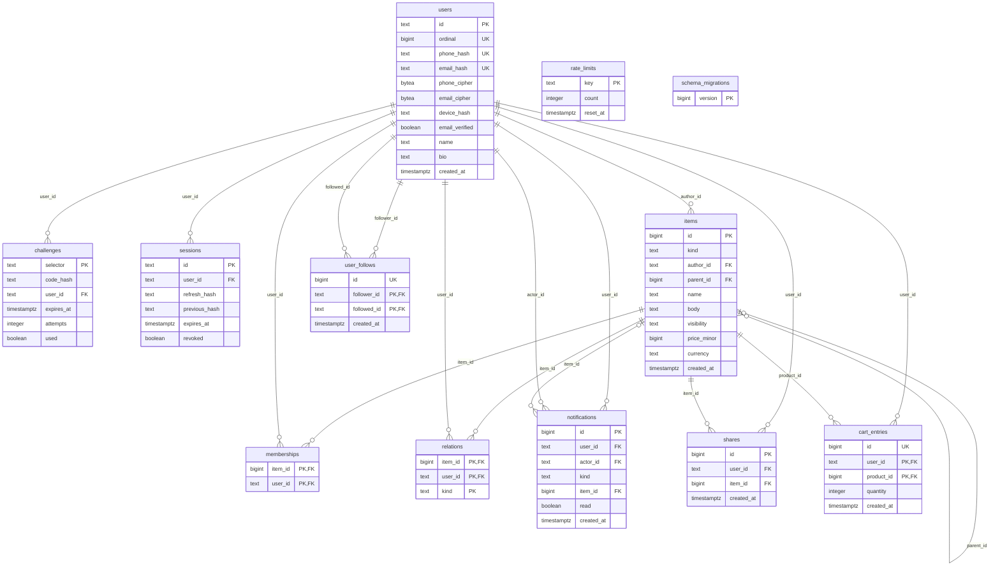
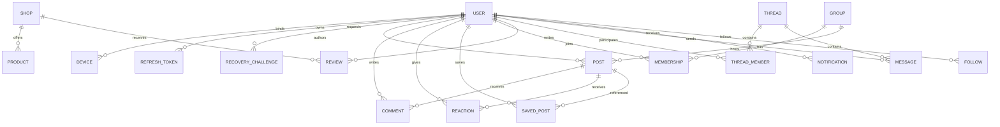

# Physical ERD — current migration, with planned model kept separate

Source read: `backend-go/migrations/000001_init.up.sql`,
`000002_activity.up.sql` and `cmd/migrate/main.go` (versions1,2; reverse order down).
This documents the checked-in SQL, not proof that migrations ran or G8 passed.
Parallel backend edits require rechecking this diagram before final acceptance.

## Actual tables and foreign keys

`schema_migrations` is created by the runner, not the up SQL. `rate_limits` and
`schema_migrations` have no foreign keys. All declared foreign keys use ON DELETE
CASCADE, including the self-reference on items.parent_id; parent_id is nullable.
users.ordinal and items.id are generated identity columns. Composite primary keys
are memberships(item_id,user_id) and relations(item_id,user_id,kind).

SQL constraints: unique normalized lookup digests for phone/email; attempts>=0;
items.kind restricted to post/comment/shop/product/group/thread/message;
visibility public/private; price_minor>=0; name length<=120 and body length<=5000;
relations.kind restricted to like/save/follow. Indexes: challenges_user_idx,
sessions_user_idx, rate_limits_reset_idx, items_kind_id_idx(kind,id DESC),
items_parent_idx(parent_id,id DESC), memberships_user_idx(user_id,item_id), plus
primary/unique indexes. No EXPLAIN or performance acceptance is implied.

Migration2 adds four tables: user_follows (composite follower/followed primary key,
no self-follow, generated unique id), notifications (follow/share kinds only,
nullable item_id, user+descending-id index), shares (unique user/item), cart_entries
(composite user/product key, generated unique id, quantity1–99). All their declared
foreign keys cascade on deletion. There are now11 migration-created application
tables plus runner-created schema_migrations. Activity implementation is present
in source; final integration/acceptance verification is still pending.

There are no separate device, product, message, review or refresh
tables: current device binding is users.device_hash; sessions store credential
digests and revocation state; social entities use items.kind. Membership and
relation authorization/type rules require service-layer review; the SQL foreign
keys alone do not enforce parent kind, thread membership or private visibility.
Current rate-limit storage is PostgreSQL, not Redis. Table presence does not
establish source UI/content parity or completeness of planned capabilities.

## Planned logical model — NOT implemented tables

The following retained target separates future domain concepts. It must not be
used as a physical-schema inventory or evidence that these features exist.

Constraints required: normalized email uniqueness and phone identity lookup;
PII ciphertext plus keyed lookup hashes (not plaintext unique indexes);
device binding/recovery consumption in a single transaction. Store only a digest
of each refresh credential. Retain lifecycle and revocation metadata separately.
Planned challenge metadata includes expiry, attempt count, consumption time and binding;
unique user+post reaction/save; unique group+member; message sender must be a
thread member; private groups/posts require authorization. Index feed/group/user
cursor columns and foreign keys; validate with EXPLAIN, not assumptions.

The target model above does not change current SQL. Schema extensions and an
actual reversible migration test remain backend-owner work. G8 needs review of
the actual-schema section plus the complete documentation bundle, not this plan.
