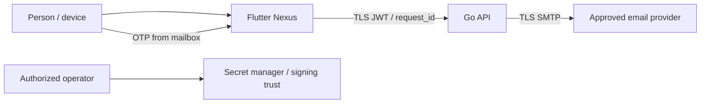
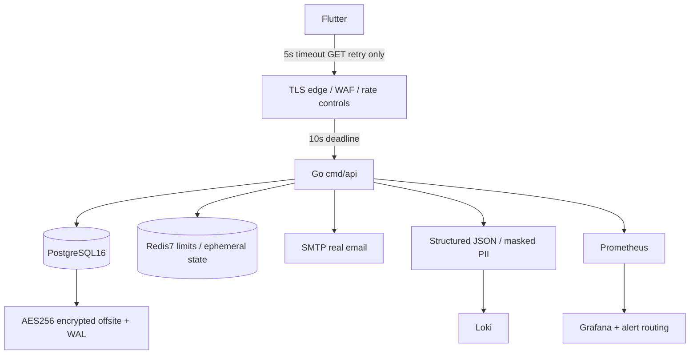

# Software architecture / C4

**Target design, not a verified inventory of implemented behavior.** Actual schema,
routes and runtime integrations must be reconciled with module owners before G6.

## Level 1 — context

## Level 2 — containers

## Level 3 — boundaries

Mobile presentation/domain/data; generated DTO interface from backend OpenAPI;
same interface for mocks and live adapter. API router→validation→auth/social
services→repositories. Context first arg; wrapped errors; no mutable globals.
Fixed JWT HS256 algorithm and sufficiently strong rotated secret; short-lived
access, single-use rotating refresh with replay detection/revocation.
OTP challenge must bind phone/email/device/recovery transaction, use hashed OTP,
bounded attempts/TTL and atomic consume+device update; do not infer bind security
from `{otp,device_id}` alone. Redis state across replicas; database constraints
are final authority for uniqueness and race safety.

## Deployment/security decisions

Compose is local scaffold only, not TLS ingress, HA or autoscaling. Secret files
outside repo; API uid10001/read-only/drop-all capabilities; no DB/Redis host ports.
Production requires approved immutable image digests, PII encryption key custody,
TLS≥1.2/HSTS/cert rotation, mobile pin rotation plan, backups/restore, storage
rights, OWASP review and operational identities. Prototype photo and remote icon
font need licensing/offline asset review before redistribution.

Threats to validate: device enumeration, OTP brute force/lockout and replay,
JWT algorithm confusion, token theft, IDOR on social/private group data, SQLi,
XSS from imported HTML/content, upload abuse, SSRF via link previews, PII logs,
cross-tenant deletion, recovery email uniqueness and concurrent device updates.
